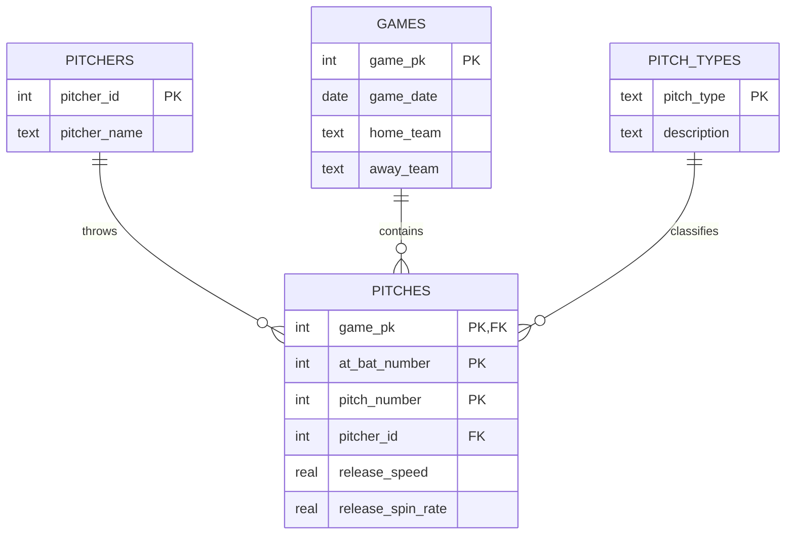

# Schema

## Design choices (be ready to explain these)

- **Why split pitchers and games out?** Raw Statcast repeats the pitcher's name
  and the game's teams and date on every pitch. Storing them once avoids that
  repetition and keeps names consistent.
- **Why a 3-column primary key on pitches?** A pitch is uniquely identified by
  its game, at-bat number and pitch number within the at-bat. The same key is
  what the dedupe step uses, so reruns can't create duplicates.
- **Why these indexes?** The dashboard filters by pitcher and the queries group
  by date, so those are the lookup paths worth indexing.
- **Why null out bad speeds instead of dropping the row?** The pitch still
  happened; only one reading is wrong. Dropping it would undercount pitches.
